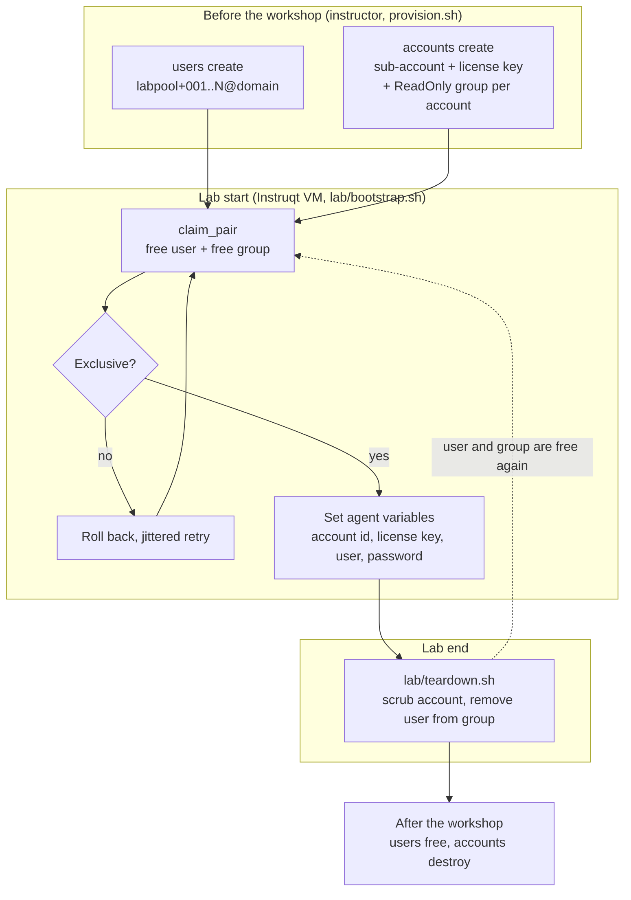
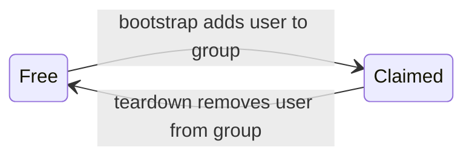

# pool-lab

## Purpose

`pool-lab/` is a standalone kit that gives every learner in an Instruqt lab their own New Relic sub-account and a read-only login, without the multi-minute account setup at lab start.
It reuses the pool-user and sub-account idea from the MARS track, but it targets a different, non-MARS New Relic org and runs on a stock Instruqt image (curl and jq only, no Terraform, no custom VM image).
It is sized for roughly 15-20 learners.

No MARS file is touched or depended on.
Nothing under `scenarios/`, `mars-program/`, `scripts/` or `automation/` changes, and MARS keeps working exactly as before.
Background and evidence for the design are in `SUBACCOUNT-POOL-REUSE-REPORT.md` at the repo root, and the MARS pool-user model is described in `docs/pool-user-management.md`.

## How it works

The slow parts are done once, by the instructor, before the workshop.
At lab start the VM only pairs a free user with a free group, so there is no propagation wait.

- **Pool users** `${POOL_EMAIL_PREFIX}NNN@${POOL_USER_DOMAIN}` are created ahead of time.
  A user with no group memberships is free.
- **Lab accounts** are sub-accounts named `<LAB_ACCOUNT_PREFIX> NN`, each with an ingest license key and a group `<account name> - ReadOnly` that already holds `LAB_READONLY_ROLE` on that account.
  A group with no members is free.
- **Claim** (lab start): `lab/bootstrap.sh` picks a random free user and a random free group, adds the user to the group, then checks that nobody else claimed either one.
  On a collision it removes its own membership and retries with jittered backoff.
- **Scrub and release** (lab end): `lab/teardown.sh` first deletes everything the learner created in the account (`lib/scrub.sh`), then removes the user from the group.
  Groups and accounts persist for reuse, and the next learner who claims the account starts from blank.





### Layout

```text
pool-lab/
├── README.md
├── .env.example                  # instructor-side variables
├── provision.sh                  # instructor CLI (run before and after the workshop)
├── invites.json                  # optional, gitignored: accept links + shared password from the Apps Script
├── build-lab-scripts.sh          # builds self-contained dist/setup-<vm> and dist/cleanup-<vm>
├── lib/
│   ├── common.sh                 # gql(), context, user/group/account/key lookups, agent_var_set/get
│   ├── claim.sh                  # claim_pair(): pairing with exclusivity check and rollback
│   └── scrub.sh                  # scrub_account(): delete everything a learner created in a lab account
├── lab/
│   ├── bootstrap.sh              # runs in the Instruqt VM at lab start
│   └── teardown.sh               # runs in the Instruqt VM at lab end
├── instruqt/
│   └── config.snippet.yml        # env and secrets to add to the track's config.yml
├── selenium/
│   ├── pool_users.py             # Chrome tooling: accept invites, validate and reset the shared password
│   ├── requirements.txt
│   └── README.md                 # venv setup, modes, env vars, invites.json format
├── appsscript/
│   ├── parse-invitations.gs      # optional Google Apps Script: Gmail invites -> invites.json
│   └── README.md
├── tests/                        # offline tests (stubbed gql, no network, no browser)
└── dist/                         # generated, gitignored
```

## Runbook

### Before the workshop

Run everything in this part from your own machine.
`provision.sh` works on macOS bash 3.2 and needs `jq` and `curl`.

1. **Set up the environment.**

   ```bash
   cd pool-lab
   cp .env.example .env
   # edit .env: NEW_RELIC_API_KEY, NR_REGION, POOL_USER_DOMAIN, POOL_EMAIL_PREFIX, LAB_ACCOUNT_PREFIX, counts
   set -a; source .env; set +a
   ```

   `pool-lab/.env` is gitignored.
   The key must be a User API key with Organization Manager permissions that belongs to a user in the group named by `LAB_ADMIN_GROUP_NAME` (see "Required key permissions").

2. **Preview the pool users, then create them.**
   `--dry-run` performs read-only lookups and makes no changes.

   ```bash
   ./provision.sh users create --dry-run
   ./provision.sh users create
   ./provision.sh users status
   ```

3. **Accept the invites manually.**
   New Relic emails each invite to the exact address `users create` used, `${POOL_EMAIL_PREFIX}NNN@${POOL_USER_DOMAIN}`.
   The address does not need to exist as its own mailbox, but the part before the `+` must be a real mailbox, group or alias that you can read.
   Mail systems such as Google Workspace and Gmail drop the `+tag` and deliver to the base address, so `labpool+001@yourdomain.com` arrives in `labpool@yourdomain.com`.
   If `labpool@yourdomain.com` does not exist, the invite bounces, the user stays in a pending state, and nobody can ever set its password.
   Check this before running `users create`, by sending a test mail to `<prefix>test@<domain>`.
   The two easy ways to get a readable base address are:
   - **Your own mailbox.** Set `POOL_EMAIL_PREFIX` to your mailbox name plus `+lab`, for example `jane.doe+lab`, so users become `jane.doe+lab001@yourdomain.com` and all land in your inbox.
   - **A group or alias.** Create `labpool@yourdomain.com` as a Google Group (or alias) with you as a member and keep the default `labpool+`.
     For example, with a Google Group `labpool@example.com` that you own, set `POOL_EMAIL_PREFIX=labpool+` and `POOL_USER_DOMAIN=example.com`, so the pool users are `labpool+001@example.com` and so on.
     **Test this first.**
     Send a test mail to `labpool+test@example.com` and confirm it reaches the group before you run `users create`.
     Delivery of plus-addresses to a Google Group on your Workspace has not been verified, and a bounced invite leaves that user pending.
   Do not reuse a MARS prefix or domain such as `mars+…@example.com`, because those invites would go to the MARS mail group.
   Open each invite and accept it, which is about 15-20 clicks.
   Filtering your inbox on the `To:` header (for example `labpool+`) makes the invites easy to find.
   Set the **same password** for every pool user, and keep it for the lab secret in the next part.
   Re-run `users status` to confirm all N users exist.

4. **Optional: automate the invite acceptance.**
   Skip this if you accepted the invites by hand in step 3.
   Otherwise, a small Google Apps Script collects the invites and a Selenium tool accepts them:
   1. Set up and run `appsscript/parse-invitations.gs` as described in `appsscript/README.md`.
      It needs no GCP project, and it emails you a JSON array of `{to, accept_link, password}`.
   2. Save that JSON as `pool-lab/invites.json` (gitignored, because it holds the shared password).
   3. Set up the Selenium venv once (see `selenium/README.md`), then:

   ```bash
   ./provision.sh users accept-invites --dry-run
   ./provision.sh users accept-invites --headless
   ```

   The tool sets the shared password on each pool user and logs in once to prove it works.
   These commands talk to the New Relic web UI, so they need no API key.

5. **Confirm every pool user logs in with the shared password.**
   Do this after the invites are accepted, whether by hand or with the tool.
   `validate-passwords` is read-only and changes nothing.

   ```bash
   export POOL_PASSWORD='the-shared-password'
   ./provision.sh users validate-passwords --dry-run
   ./provision.sh users validate-passwords --headless
   ```

   The dry run lists the addresses and starts no browser.
   The real run logs in as each user and prints one `OK` or `FAIL` line per user, and exits non-zero if any failed.
   Fix every `FAIL` before the workshop (see Troubleshooting).
   If you later change the shared password with `users reset-passwords`, run this check again.

6. **Preview and create the lab accounts.**
   Do the dry run first.

   ```bash
   ./provision.sh accounts create 2 --dry-run
   ./provision.sh accounts create 2        # small trial first, see "Known unverified"
   ./provision.sh accounts create          # then the full LAB_ACCOUNT_COUNT
   ./provision.sh accounts status
   ```

   For each account, `accounts create` does the following, and is idempotent so a failed run can simply be repeated:
   - create the sub-account `<LAB_ACCOUNT_PREFIX> NN`;
   - grant the admin group (`LAB_ADMIN_GROUP_NAME`) `LAB_ADMIN_ROLE` on it;
   - poll until the key can see the account, which is the slow propagation wait of about 10 minutes, paid once here instead of at every lab start;
   - create the ingest `LICENSE` key;
   - create the group `<account name> - ReadOnly`;
   - grant that group `LAB_READONLY_ROLE`.

7. **Check the pool.**
   `users status` and `accounts status` should show N free users and N free groups.

8. **Test the mapping without Instruqt (optional).**
   `./provision.sh pair claim` does what the lab does at start-up: it claims a free pool user and a free lab group and prints the account id and whether the license key is readable.
   `./provision.sh pair claim labpool+001@example.com "INSTRUQT_LAB 01"` maps that exact pair instead.
   It stores nothing; undo it with `./provision.sh users free <email>`.
   Add `--dry-run` to list the free users and groups without claiming.

All commands accept `--yes` to skip confirmation prompts and `--dry-run` to do read-only lookups with zero mutations.

### At lab start

These steps are done once per track, not once per learner.

1. **Build the self-contained lab scripts.**

   ```bash
   ./build-lab-scripts.sh --vm <vm-name> --out dist
   ```

   This concatenates `lib/common.sh`, `lib/claim.sh` and the lab script into `dist/setup-<vm>` and `dist/cleanup-<vm>`.
   `--vm` names the Instruqt VM the scripts are for (see `./build-lab-scripts.sh --help` for its default), and `--out` sets the output directory (`dist/` by convention).

2. **Copy them into the track.**
   Copy `dist/setup-<vm>` and `dist/cleanup-<vm>` into the track's `track_scripts/` directory, and make sure they are executable.

3. **Add the env and secrets to the track's `config.yml`.**
   See `instruqt/config.snippet.yml`.
   You need two Instruqt secrets: the NerdGraph User API key and the shared pool-user password.
   The scripts read them by indirection, as MARS does with `NR_API_KEY_SECRET`:
   - `LAB_NR_API_KEY_SECRET` holds the **name** of the Instruqt secret that contains the NerdGraph key;
   - `LAB_USER_PASSWORD_SECRET` holds the **name** of the Instruqt secret that contains the shared password.

   The prefixes (`POOL_EMAIL_PREFIX`, `LAB_ACCOUNT_PREFIX`), `POOL_AUTH_DOMAIN_NAME` and `NR_REGION` must match what you used with `provision.sh`.

4. **What the learner gets.**
   `bootstrap.sh` claims a pair and sets these agent variables for your challenges to use: `NEW_RELIC_ACCOUNT_ID`, `NEW_RELIC_LICENSE_KEY`, `ACCOUNT_NAME`, `NR_ORG_ID`, `POOL_USER_ID`, `POOL_USER_EMAIL`, `POOL_USER_NAME`, `USER_EMAIL`, `USER_NAME`, `POOL_GROUP_ID` and `LAB_USER_PASSWORD`.

### After the workshop

```bash
./provision.sh users free            # remove users from lab groups (never deletes groups)
./provision.sh users free <email>    # free a single user
./provision.sh accounts scrub --all --dry-run   # list what is left in the lab accounts
./provision.sh accounts scrub --all  # delete it (asks 'yes'; skips claimed accounts unless --force)
./provision.sh accounts destroy      # remove groups and cancel each account twice
./provision.sh users delete          # optional: delete the pool users
```

- `accounts scrub <account|--all>` runs the same scrub as the lab cleanup.
  Use it when a lab ended without a clean `teardown.sh`, or before a workshop to start every account blank.
  `<account>` is an id or a name such as `"INSTRUQT_LAB 02"`.
  It always shows a dry pass first and asks for `yes`.
- What the scrub deletes, in this order: Workflow Automation schedules and definitions, alert workflows (with their channels), remaining channels, destinations (including the Workflow Automation destination that stores the learner's `NRAK-` key), muting rules, alert policies (with their conditions), open issues, dashboards, synthetic monitors, every other entity (forced), and the user keys that pool users own on the account.
- What it never deletes: ingest license keys, keys of anyone who is not a pool user, the account, the lab group, and telemetry already stored.
  Data in NRDB (transactions, errors, logs, change markers) stays until its retention expires; deleting an entity only removes it from the UI and entity search.
- It refuses any account whose name is not `<LAB_ACCOUNT_PREFIX> NN`.

- `users free` only removes users from lab groups and never deletes the groups.
  Use it to recover from labs that ended without running `teardown.sh`.
- `accounts destroy` removes the groups and cancels each account twice, because New Relic needs two cancellation steps to fully delete an account.
- Run `accounts status` and `users status` afterwards to confirm nothing is left.

## Phase 2 (planned, not implemented)

A later mode could replace the dynamic claim with a fixed user-to-account manifest (user N always maps to account N), which the lab would simply read.
The seam for it is the single pair-resolution step in `bootstrap.sh` (`resolve_pair`), so the rest of the script would not change.
Nothing in this kit implements that mode today, and no `LAB_MAPPING_MODE` variable is read.

## Required key permissions

- A **User API key** (`NRAK-...`), not an ingest or license key.
- **Organization Manager** permissions, for sub-account creation and cancellation, and for user and group management.
- The key's user must belong to the group named by `LAB_ADMIN_GROUP_NAME`.
  That group is granted `LAB_ADMIN_ROLE` on each new account, and the role must allow ingest license key creation (the default `all_product_admin` does).
- The exact minimum permission set is not verified.

## Collision handling: difference from MARS

MARS pairs a user with a group that is created per track, so only the user can be claimed twice.
Pool-lab has two shared pools, so both sides can collide: two labs can pick the same user, the same group, or both.

After adding a membership, `claim_pair` re-reads all pool users and checks that the user belongs to exactly one group and that the group has exactly one pool-user member.
If either check fails, the lab removes its own membership, skips that user or group on the next attempt, and retries after a jittered delay, up to `LAB_CLAIM_MAX_ATTEMPTS` (default 8).

**Both colliding labs roll back and retry.**
There is deliberately no tie-break (such as "smallest id keeps the claim").
A tie-break assumes every lab sees the same picture, but reads are eventually consistent, so one lab could think it won while the other also thinks it won, and both would keep the claim.
Rolling back both is slower in the rare collision case, but it can never leave two labs sharing a user or a group, and the jitter makes the retries diverge quickly.

## Known unverified

These GraphQL shapes were written from documentation and from the MARS code, and have not been tested against the live schema or a live org.
The offline tests stub `gql`, so they cannot catch a wrong shape.

| Item | Where used | Risk |
| --- | --- | --- |
| `accountManagementCreateAccount` input shape | `provision.sh accounts create` | Field names or the region value (`LAB_ACCOUNT_REGION`) may differ |
| `apiAccessCreateKeys` input shape | `provision.sh accounts create` | Key type, ingest type or account scoping may differ |
| `actor.apiAccess.keySearch` returning key **values** | `license_key_for_account` in `lib/common.sh`, used by `bootstrap.sh` | The API may return only key metadata, so the license key would come back empty |
| `newrelic` CLI profile fallback | `gql()` in `lib/common.sh` | The output shape of `newrelic nerdgraph query` is normalised on a best-effort basis |
| EU login and UI hosts (`login.eu.newrelic.com`, `one.eu.newrelic.com`) | `selenium/pool_users.py` with `NR_REGION=EU` | Hosts or page layout may differ; untested |
| Plus-address delivery to a Google Group (`labpool+test@example.com`) | Invite delivery in "Before the workshop" | Not verified on your Workspace; send a test mail first |
| Login page selectors | `selenium/pool_users.py` | Written against the MARS tool and not run against pool-lab; New Relic page changes break them |
| Scrub deletes | `lib/scrub.sh`, `accounts scrub`, `teardown.sh` | Every list query was checked live with `--dry-run` (2026-10-30); no delete has run yet. Unknown: which entity types `entityDelete` accepts, and whether the Organization Manager key may delete a pool user's user key |

Before relying on the kit:
1. Run every `provision.sh` command with `--dry-run` first.
2. Do a two-account trial (`accounts create 2`) and then run `lab/bootstrap.sh` once against it to confirm the license key is found.
3. Prefer `NEW_RELIC_API_KEY` over the CLI profile fallback.

**If `keySearch` does not return key values:** the planned fallback is for `accounts create` to write the keys to a gitignored manifest that you paste into one Instruqt secret, which the lab would read instead of calling the API.
That fallback is **not implemented**.
Until then, a lab whose key lookup comes back empty fails at bootstrap.

## Troubleshooting

| Symptom | Likely cause | Fix |
| --- | --- | --- |
| `Failed to resolve NR org ID` | Wrong key, wrong region, or key lacks permission | Check `NEW_RELIC_API_KEY`, `NR_REGION` and `NR_GRAPHQL_URL`; use a User key |
| `Auth domain 'Default' not found` | Org uses a different authentication domain name | Set `POOL_AUTH_DOMAIN_NAME` |
| `No free pool users` | Users not created, all claimed, or prefix mismatch | `users status`; `users create`; `users free`; check `POOL_EMAIL_PREFIX` matches on the VM |
| `No free lab groups` | Accounts not created, all claimed, or prefix mismatch | `accounts status`; `accounts create`; check `LAB_ACCOUNT_PREFIX` matches on the VM |
| `Could not claim an exclusive user/group pair` | Many labs starting at once and colliding | Retry the lab; raise `LAB_CLAIM_MAX_ATTEMPTS`; stagger starts; make sure the pool is larger than the class |
| Pool user shows as occupied after a lab ended | Cleanup did not run (VM lost) | `./provision.sh users free <email>` |
| Learner cannot log in | Invite not accepted, or password differs from the lab secret | Accept the invite; use one password for every pool user and put it in the lab secret; check with `users validate-passwords` |
| Invite bounced, or pool user stays pending | The base mailbox/group before the `+` does not exist, or plus-address delivery to your group does not work | Test with a mail to `<prefix>test@<domain>` before `users create`; fix the group, then `users delete` and `users create` again so a fresh invite is sent |
| `users validate-passwords` shows FAIL for some users | Invite not accepted yet, different password on that user, or MFA | Read the reason printed per user; accept the invite; re-run `users accept-invites` or set the password by hand; check `POOL_PASSWORD` |
| Chrome or chromedriver errors from the browser commands | Chrome missing or outdated, driver download blocked, or the venv is missing | Install Chrome; allow internet on the first run; recreate the venv (`selenium/README.md`); set `POOL_LAB_PYTHON` if the venv is elsewhere |
| Browser commands fail with `NR_REGION=EU` | The EU hosts (`login.eu.newrelic.com`, `one.eu.newrelic.com`) are unverified | Treat EU as untested; accept and validate by hand, or check the hosts and fix `pool_users.py` |
| `accounts create` waits a long time | Admin grant propagation | Expected (about 10 minutes per account); raise `LAB_PROPAGATION_POLLS` if it times out |
| `accounts create` fails on the admin grant | Admin group name wrong, or key's user is not in it | Check `LAB_ADMIN_GROUP_NAME` and the key's user membership |
| Empty license key at bootstrap | `keySearch` does not return key values | See "Known unverified" |
| `agent_var_set` fails after retries | Instruqt agent unavailable | Re-run the setup script; check the agent in the VM |
| `jq: command not found` or `curl: command not found` | Tools missing on the machine | Install them (the lab image normally has both) |

## Tests

All tests are offline.
They stub `gql` and make no network calls, so they are safe to run anywhere.

```bash
./tests/claim-test.sh       # claim_pair: clean claim, user and group collisions, empty pools
./tests/provision-test.sh   # provision.sh subcommands, including --dry-run making no mutations
./tests/bootstrap-test.sh   # lab/bootstrap.sh and teardown.sh with a file-backed agent variable store
./tests/scrub-test.sh       # lib/scrub.sh and accounts scrub: order, guards, dry run, kept keys, failures
./tests/pool-users-test.sh  # selenium/pool_users.py and the users accept-invites / validate-passwords / reset-passwords wrappers (no browser)
```

Also run `bash -n` and `shellcheck` on every script before changing anything.
